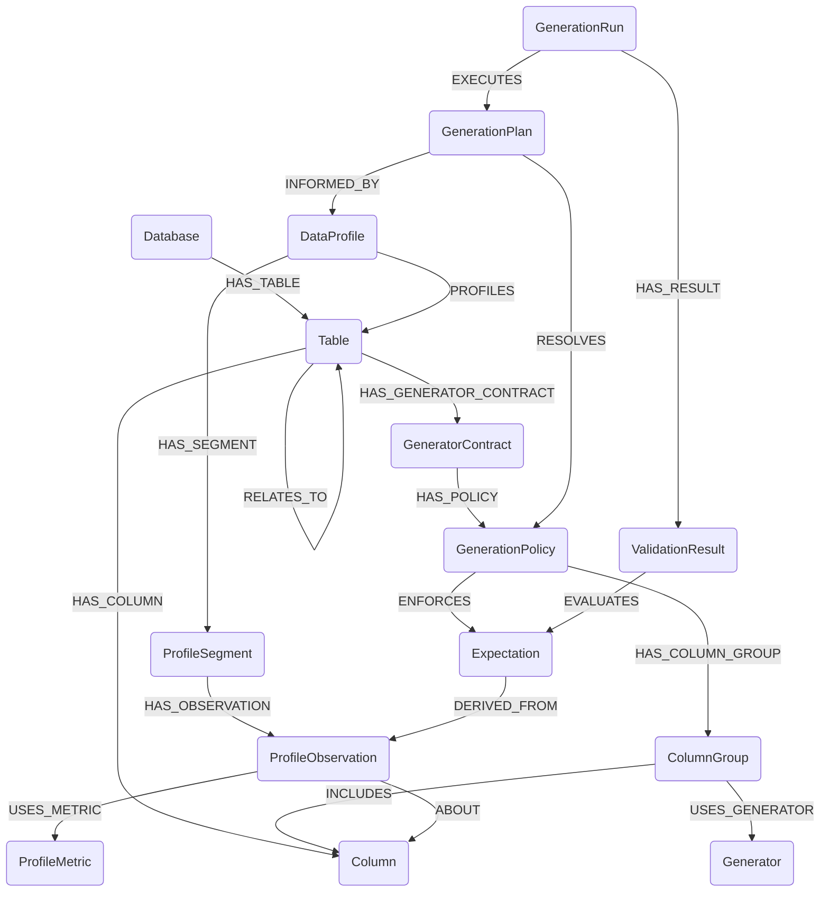

# Test Data Factory Ontology

The Test Data Factory is a contract-driven system for generating synthetic test data.

The ontology represents database structures, generation contracts, policies, generators, data profiles, profiling observations, generation plans, runs and validation results.

The graph acts as the control plane for data generation. Actual generated records are stored outside the knowledge graph.

The diagram source of truth is [`ontology.mmd`](ontology.mmd). Keep this document and that file in sync.

## Diagram

## Conceptual Areas

- **Schema:** Database, Table, Column
- **Generation:** GeneratorContract, GenerationPolicy, Expectation, ColumnGroup, Generator
- **Profiling:** DataProfile, ProfileSegment, ProfileObservation, ProfileMetric
- **Execution:** GenerationPlan, GenerationRun, ValidationResult

Table and Column are the shared anchor points. Table links schema to generation (through contracts) and to profiling (through `PROFILES`). Column is referenced by generation (`INCLUDES`) and profiling (`ABOUT`). Execution links the other areas: plans resolve policies and use profiles, runs execute plans, and validation results evaluate expectations.

## Node Labels

### Database

Represents a source or target database containing tables that may be profiled or used for synthetic data generation.

### Table

Represents a database table. Defines the scope for generation contracts and participates in relationships with other tables.

### Column

Represents a column belonging to a table, including its structural characteristics and data type.

### GeneratorContract

Defines the requirements and intended outcomes for generating synthetic data for a particular table.

### GenerationPolicy

Defines how a generation contract is fulfilled, including applicable expectations and the organisation of generation work into column groups. Policies may vary according to testing intent, such as functional, performance or edge-case testing.

### Expectation

Represents a data-quality or behavioural assertion that generated data must satisfy, or intentionally violate for a specified negative test scenario. May be informed by profiling observations or explicitly defined business rules.

### ColumnGroup

Groups columns that are generated together under a particular policy. Supports correlated attributes and coordinated generation.

### Generator

Represents an executable generation capability or strategy responsible for producing values for a column group. Examples include deterministic, rule-based, statistical and distribution-based generators.

### DataProfile

Represents a profiling result for a table, capturing observed characteristics of source data. A table may have multiple profiles from different profiling runs.

### ProfileSegment

Represents a population or subset of records within a data profile. Allows profiling observations to be associated with specific data populations.

### ProfileObservation

Represents a measured characteristic of a column within a particular profile segment. Stores the observed result of applying a profiling metric.

### ProfileMetric

Defines a reusable profiling measurement, such as null count, distinct non-null count, minimum, maximum, mean or observed value set.

### GenerationPlan

Represents the resolved set of execution instructions derived from contracts, policies, column groups, metadata and available profiling observations. Identifies the selected generators, dependencies, parameters and validation requirements.

### GenerationRun

Represents one execution of a generation plan, including its configuration, seed, outputs, validation results and execution metadata.

### ValidationResult

Represents the outcome of evaluating one expectation for a generation run, including relevant failures, evidence and diagnostics.

## Relationships

### Summary

| Type | From | To | Description |
|------|------|----|-------------|
| `HAS_TABLE` | Database | Table | Associates a database with its tables. |
| `HAS_COLUMN` | Table | Column | Associates a table with its columns. |
| `RELATES_TO` | Table | Table | Represents a relationship between two tables, including cardinality and the columns used to establish it. May represent foreign-key or other defined associations. |
| `HAS_GENERATOR_CONTRACT` | Table | GeneratorContract | Associates a table with a contract governing the generation of its synthetic data. |
| `HAS_POLICY` | GeneratorContract | GenerationPolicy | Associates a contract with one or more generation policies. |
| `ENFORCES` | GenerationPolicy | Expectation | Identifies the expectations enforced by a policy, including requirements deliberately violated in negative testing. |
| `HAS_COLUMN_GROUP` | GenerationPolicy | ColumnGroup | Defines the column groups managed by a generation policy. |
| `INCLUDES` | ColumnGroup | Column | Identifies the columns belonging to a generation group. |
| `USES_GENERATOR` | ColumnGroup | Generator | Associates a column group with the generator responsible for producing its values. |
| `PROFILES` | DataProfile | Table | Identifies the table whose data was analysed by a profile. |
| `HAS_SEGMENT` | DataProfile | ProfileSegment | Associates a profile with its analysed data populations or segments. |
| `HAS_OBSERVATION` | ProfileSegment | ProfileObservation | Associates a profile segment with its measured observations. |
| `ABOUT` | ProfileObservation | Column | Identifies the column to which a profiling observation applies. |
| `USES_METRIC` | ProfileObservation | ProfileMetric | Identifies the metric used to produce an observation. |
| `RESOLVES` | GenerationPlan | GenerationPolicy | Identifies the policy resolved into a plan. |
| `INFORMED_BY` | GenerationPlan | DataProfile | Identifies the profile whose observations informed a plan. |
| `EXECUTES` | GenerationRun | GenerationPlan | Identifies the plan executed by a run. |
| `HAS_RESULT` | GenerationRun | ValidationResult | Associates a run with its validation results. |
| `EVALUATES` | ValidationResult | Expectation | Identifies the expectation evaluated by a validation result. |
| `DERIVED_FROM` | Expectation | ProfileObservation | Identifies the profiling observation from which an inferred expectation was derived. |

### Details

#### HAS_TABLE

`(:Database)-[:HAS_TABLE]->(:Table)`

Associates a database with its tables.

#### HAS_COLUMN

`(:Table)-[:HAS_COLUMN]->(:Column)`

Associates a table with its columns.

#### RELATES_TO

`(:Table)-[:RELATES_TO]->(:Table)`

Represents a relationship between two tables, including cardinality and the columns used to establish the relationship. May represent foreign-key relationships or other defined associations.

#### HAS_GENERATOR_CONTRACT

`(:Table)-[:HAS_GENERATOR_CONTRACT]->(:GeneratorContract)`

Associates a table with a contract governing the generation of its synthetic data.

#### HAS_POLICY

`(:GeneratorContract)-[:HAS_POLICY]->(:GenerationPolicy)`

Associates a contract with one or more generation policies.

#### ENFORCES

`(:GenerationPolicy)-[:ENFORCES]->(:Expectation)`

Identifies the expectations enforced by a policy, including requirements that may be deliberately violated in negative testing.

#### HAS_COLUMN_GROUP

`(:GenerationPolicy)-[:HAS_COLUMN_GROUP]->(:ColumnGroup)`

Defines the column groups managed by a generation policy.

#### INCLUDES

`(:ColumnGroup)-[:INCLUDES]->(:Column)`

Identifies the columns belonging to a generation group.

#### USES_GENERATOR

`(:ColumnGroup)-[:USES_GENERATOR]->(:Generator)`

Associates a column group with the generator responsible for producing its values.

#### PROFILES

`(:DataProfile)-[:PROFILES]->(:Table)`

Identifies the table whose data was analysed by a profile.

#### HAS_SEGMENT

`(:DataProfile)-[:HAS_SEGMENT]->(:ProfileSegment)`

Associates a profile with its analysed data populations or segments.

#### HAS_OBSERVATION

`(:ProfileSegment)-[:HAS_OBSERVATION]->(:ProfileObservation)`

Associates a profile segment with its measured observations.

#### ABOUT

`(:ProfileObservation)-[:ABOUT]->(:Column)`

Identifies the column to which a profiling observation applies.

#### USES_METRIC

`(:ProfileObservation)-[:USES_METRIC]->(:ProfileMetric)`

Identifies the metric used to produce an observation.

#### RESOLVES

`(:GenerationPlan)-[:RESOLVES]->(:GenerationPolicy)`

Identifies the policy resolved into a plan.

#### INFORMED_BY

`(:GenerationPlan)-[:INFORMED_BY]->(:DataProfile)`

Identifies the profile whose observations informed a plan.

#### EXECUTES

`(:GenerationRun)-[:EXECUTES]->(:GenerationPlan)`

Identifies the plan executed by a run.

#### HAS_RESULT

`(:GenerationRun)-[:HAS_RESULT]->(:ValidationResult)`

Associates a run with its validation results.

#### EVALUATES

`(:ValidationResult)-[:EVALUATES]->(:Expectation)`

Identifies the expectation evaluated by a validation result.

#### DERIVED_FROM

`(:Expectation)-[:DERIVED_FROM]->(:ProfileObservation)`

Identifies the profiling observation from which an inferred expectation was derived. Profiling observations are evidence, not approved requirements; derived expectations start as proposed.

## Documented Properties

Only the following properties are defined so far.

### Expectation

| Property | Values | Description |
|----------|--------|-------------|
| `source` | `INFERRED`, `DECLARED`, `IMPORTED` | How the expectation originated. |
| `status` | `PROPOSED`, `APPROVED`, `REJECTED`, `RETIRED` | Lifecycle state. Inferred expectations must not automatically become approved. |

### ValidationResult

| Property | Values | Description |
|----------|--------|-------------|
| `outcome` | `SATISFIED`, `UNEXPECTED_VIOLATION`, `EXPECTED_VIOLATION`, `UNEVALUATED` | Result of evaluating the expectation. |

## Conventions

- Node labels are PascalCase; relationship types are UPPER_SNAKE_CASE.
- Relationship directions are as shown in the diagram (for example, `PROFILES` goes from DataProfile to Table).

## Open Questions

- **Properties:** node and relationship properties other than those under Documented Properties are not yet defined. This includes the cardinality and join columns on `RELATES_TO`. See the open architectural decisions in [`PRD.md`](PRD.md).
- **Naming:** the contract node is `GeneratorContract`, but the policy node remains `GenerationPolicy`. Confirm whether the naming should be aligned.
